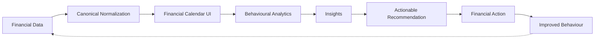

# Finora

> **Financial Behaviour Intelligence Platform**  
> *A clearer view of daily cash flow, financial habits, and the next decision.*

---

## 🌟 The Core Value Loop



Unlike generic personal finance dashboards that treat money as a static ledger, **Finora** introduces:
1. **The Financial Calendar**: Organizes canonical cash flow across days, weeks, and months.
2. **Canonical Transaction Architecture**: A unified transaction model for simulated bank streams and reviewed statement imports. CSV parsing is available; PDF/image OCR is optional and not yet accuracy-validated.
3. **Behavioural Intelligence**: Statistical spending summaries, forecasts, anomaly heuristics, and FIRE scenarios. The current system does not use a trained ML model or Isolation Forest.

---

## 🏛️ Architecture Overview

The system is built as a **Modular Monolith**:
- **Frontend**: Next.js 16.4.6 (App Router), TypeScript, Tailwind CSS, TanStack Query, Framer Motion, Recharts.
- **Backend API**: Python FastAPI, Pydantic v2 schemas, SQLAlchemy 2.0 async ORM.
- **Persistence**: Local development defaults to SQLite; Supabase Postgres is configured for hosted data. The initial schema migration is applied to the configured project.
- **Authentication**: Supabase Auth email/password signup, sign-in, PKCE password-recovery callback, and dashboard protection are implemented. Email confirmation is off for the current demo, so users can enter an unverified email; this does not prove email ownership. Password recovery requires working email delivery; see [Supabase setup](docs/supabase/setup.md).
- **Simulated Integrations**: Pluggable `BankAdapter` contracts (e.g. `HSBCDemoAdapter`) with zero storage of real credentials.

Detailed system documentation is available in `docs/`:
- [System High-Level Design (HLD)](docs/architecture/hld.md)
- [Low-Level Design (LLD)](docs/architecture/lld.md)
- [Database ER Schema](docs/architecture/database.md)
- [Canonical Transaction Pipeline](docs/architecture/transaction-flow.md)
- [Bank Adapter Architecture](docs/architecture/bank-adapters.md)
- [Statement Ingestion Engine](docs/architecture/statement-import.md)
- [ML & Behavioural Analytics](docs/architecture/ml-architecture.md)
- [Security & Privacy Architecture](docs/architecture/security.md)
- [Supabase setup and schema deployment](docs/supabase/setup.md)
- [Vercel deployment and environment variables](docs/deployment/vercel.md)
- [Product Requirements (PRD)](docs/product/requirements.md)
- [Engineering Roadmap](docs/product/roadmap.md)

---

## 🎓 Academic Evaluation & Learning Hub (AP & DE)

Curated study guides and manual coding cheatsheets for **Advanced Programming (AP)** and **Data Engineering (DE)** course evaluations at Newton School of Technology:
- [📘 Master Evaluation Roadmap](Learning/README.md)
- [01: JavaScript Deep Dive & Asynchronous Programming](Learning/01_JAVASCRIPT_FUNDAMENTALS_AND_ASYNC.md)
- [02: Node.js Runtime Architecture & Core Modules](Learning/02_NODEJS_RUNTIME_AND_CORE_MODULES.md)
- [03: HTTP Protocol, Networking & Raw Servers](Learning/03_HTTP_AND_NETWORKING_FOUNDATIONS.md)
- [04: Express.js Architecture & Middleware Mastery](Learning/04_EXPRESSJS_AND_MIDDLEWARE_MASTERY.md)
- [05: REST API Architecture & Design Principles](Learning/05_REST_API_ARCHITECTURE_AND_DESIGN.md)
- [06: Finora Production Codebase Deep Dive](Learning/06_FINORA_CODEBASE_DEEP_DIVE.md)
- [07: Pen & Paper Manual Coding Cheatsheet (15 Drills)](Learning/07_MANUAL_CODING_CHEATSHEET.md)
- [08: Viva & Oral Evaluation Q&A (50+ Questions)](Learning/08_VIVA_AND_ORAL_EVALUATION_QA.md)

Engineering and agent workflow:
- [Agent context](docs/agents/context.md)
- [Project continuity brief](docs/agents/project-context.md)
- [Milestone and decision history](docs/agents/history.md)
- [Website redesign workflow](docs/agents/skills/transform-ai-slop-websites/SKILL.md)
- [Agent roles](docs/agents/roles.md)
- [Contribution guide](CONTRIBUTING.md)
- [Security policy](SECURITY.md)

---

## 🚀 Getting Started

### 1. Backend Setup (FastAPI)
```bash
# Navigate to backend
cd backend

# Create & activate virtual environment
python3.13 -m venv .venv
source .venv/bin/activate

# Install dependencies
pip install -r requirements.txt

# Optional: enable local OCR for PDF, PNG, and JPG statements (Python 3.13)
pip install -r requirements-ocr.txt

# Run automated tests
DEBUG=false python -m pytest -q

# Launch FastAPI development server
uvicorn app.main:app --reload --port 8000
```
Interactive API docs available at: `http://localhost:8000/api/v1/docs`

### 2. Frontend Setup (Next.js)
```bash
# Navigate to frontend
cd frontend

# Install dependencies
npm install

# Run development server
npm run dev

# Validate frontend changes
npm run lint
npm run typecheck
npm run build
```
Client interface available at: `http://localhost:3000`
For Supabase sign-in and database setup, complete [the Supabase setup guide](docs/supabase/setup.md) first. Without project keys, the login page displays a configuration prompt.

The public landing page includes canonical metadata and a branded social
preview image. Production uses `NEXT_PUBLIC_SITE_URL` to set its canonical
host; see the [Vercel deployment guide](docs/deployment/vercel.md). The app
serves `/robots.txt` and `/sitemap.xml`; only the public landing page is
listed for search crawlers.

Keep the FastAPI and Next.js development servers running in separate terminals.
An `ECONNREFUSED 127.0.0.1:8000` error in the Next.js log means the backend
is unreachable. With both servers up, `http://127.0.0.1:8000/health` should respond.

### 3. Quality Checks

Run these checks before opening a pull request:

```bash
# Frontend
cd frontend
npm run lint
npm run typecheck
npm run build

# Backend
cd backend
pip install -r requirements-dev.txt
ruff check app tests
pytest
```

The frontend lint command uses ESLint's flat configuration with the Next.js and TypeScript rulesets. The backend Ruff configuration starts with high-signal import, undefined-name, syntax, and basic Pyflakes checks; broader style modernization can be introduced separately without making the initial quality gate noisy.

---

## 🛡️ Security & Privacy Principles
- **No Real Bank Credentials**: All bank sync operations use simulated adapter streams.
- **Granular Isolation**: Hosted-mode API access uses verified Supabase identities, transaction-scoped RLS, and tenant-scoped ORM queries. Local auth mode is demo-only.
- **Statement review**: CSV parsing maps recognized column layouts. Every row must be reviewed before confirmation; PDF and image extraction uses optional local PaddleX OCR and must be checked against the source.
- **Deterministic Deduplication**: SHA-256 fingerprints skip repeated transactions during statement imports.

## Frontend demo entry flow

The frontend opens on an explanatory landing page at `/`, with an interactive
cash-flow instrument, spending walkthrough, and wealth/FIRE scenario explorer.
The scenario uses visible assumptions and is not a prediction or investment
recommendation.

## Current integration status

- The login uses Supabase Auth SSR sessions, and the FastAPI API validates
  those access tokens and applies per-user Postgres row-level security.
- The initial Postgres migration and local environment templates are in this
  repository. The Supabase project exists, its local site URL and callback URLs
  are configured, and the project URL/publishable key are in the ignored local
  frontend and backend env files. The Session pooler URL is configured in
  `backend/.env`; the TLS connection succeeded, and the migration is applied
  with all ten expected tables protected by RLS.
- The signed-in workspace loads the current user's accounts and transactions
  from FastAPI. New users see an empty state and can create an account label,
  preview a statement, edit extracted rows, and explicitly confirm an import.
  The source file is not retained. Only confirmed canonical transactions are
  persisted. Successful API reads stay in bounded browser memory for the tab
  session, scoped to the signed-in user; relevant writes invalidate only the
  affected data groups, and same-browser tabs receive invalidations. Sign-out
  clears the cache. Entries are LRU-evicted at 60 responses or 5 MB and are
  never stored persistently. Layout-matched loading skeletons cover route,
  workspace, section, and initial data loading. The Overview fetches five recent
  rows with the API's total count and a separate monthly summary. The summary
  uses the same scoped cache and loads only for workspaces with records.
- CSV import requires recognizable date and description columns plus separate
  debit/credit columns or an explicit transaction type; amount-only CSVs are
  rejected because direction cannot be inferred safely. PDF and image OCR require the optional local dependencies in
  `backend/requirements-ocr.txt`; OCR has not been benchmarked against bank
  layouts, and extracted rows require manual review.
- `sample-statement-3-months.csv` (repo root) is a synthetic demo statement, Sep 1 to Nov 23 2026, 146 rows in the `sample-passbook.csv` column format; it contains no real names, accounts or financial data.
- Calendar, insights, budgets and goals are part of the authenticated workspace.
  Roles/RBAC management, profile editing, billing, and real bank connections
  are not. Bank adapters remain simulated; the role editor is not authorization.

Open `/login` to create a Supabase Auth account or sign in, then enter
`/dashboard`. With no imported records, the workspace explains how to add a
statement. With records, Overview opens on the latest recorded month and shows
money in, money out, net cash flow, and transaction count. Change the month or
currency to explore recorded activity. The weekly chart and spending-by-account
breakdown use confirmed records. Transfers appear in the count and recent activity.
See
[`docs/supabase/setup.md`](docs/supabase/setup.md) for project setup, local
environment values, and applying the Postgres migration. Statement import saves
reviewed records to the user's account; bank sync remains simulated and does
not connect to real financial institutions.

Use **Log out** in the workspace header to end the session in this browser.
Finora clears its session cookies before returning to sign-in.

For the current demo, Supabase Auth email confirmation is intended to be off.
When disabled, signup should create an active session and open the empty
workspace without sending a verification email. This accepts unverified email
addresses and does not prove ownership. The hosted project setting is now off;
password recovery continues to require email delivery. See the
Supabase setup guide for the exact setup and limitations.

Finora uses a stone, graphite, and brass palette with self-hosted Newsreader
and DM Sans. See [DESIGN.md](DESIGN.md) for the visual system and image
provenance. The landing page opens with a photograph of statement review and uses transparent PNG
photography that accompanies the statement, calendar, and savings examples.
The pausable cash flow instrument opens below the statement walkthrough. It
uses the adapted [Anatomy](https://github.com/wheresryan22/anatomy) SVG kit
(MIT, see `frontend/src/lib/anatomy/LICENSE`).
The desktop walkthrough uses scroll motion and keeps a vertical reading layout
on phones and with reduced motion. See the [landing motion plan](docs/agents/landing-motion.md).
