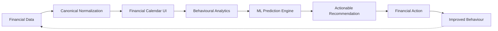

# Finora

> **Financial Behaviour Intelligence Platform**  
> *Transforming transaction tracking into an active decision engine through temporal calendar dynamics and predictive machine learning.*

---

## 🌟 The Core Value Loop



Unlike generic personal finance dashboards that treat money as a static ledger, **Finora** introduces:
1. **The Financial Calendar**: A first-class, dense temporal interface mapping cash-flows onto daily/weekly schedules with real-time spending intensity heatmaps.
2. **Canonical Transaction Architecture**: A unified ingestion pipeline transforming heterogeneous inputs (Simulated Bank Streams, CSV, XLSX, PDF) into an immutable, deduplicated domain model.
3. **Predictive Behavioural Intelligence**: Statistical velocity modeling, budget exhaustion projections, Isolation Forest anomaly alerts, and dynamic FIRE (Financial Independence) scenarios.

---

## 🏛️ Architecture Overview

The system is built as a **Modular Monolith**:
- **Frontend**: Next.js 15+ (App Router), TypeScript, Tailwind CSS, TanStack Query, Framer Motion, Recharts.
- **Backend API**: Python FastAPI, Pydantic v2 schemas, SQLAlchemy 2.0 async ORM.
- **Persistence**: PostgreSQL (with SQLite async support for local development and testing).
- **Simulated Integrations**: Pluggable `BankAdapter` contracts (e.g. `HSBCDemoAdapter`) with zero storage of real credentials.

Detailed system documentation is available in `docs/`:
- [System High-Level Design (HLD)](docs/architecture/hld.md)
- [Low-Level Design (LLD)](docs/architecture/lld.md)
- [Database ER Schema](docs/architecture/database.md)
- [Canonical Transaction Pipeline](docs/architecture/transaction-flow.md)
- [Bank Adapter Architecture](docs/architecture/bank-adapters.md)
- [Statement Ingestion Engine](docs/architecture/statement-import.md)
- [ML & Behavioural Analytics](docs/architecture/ml-architecture.md)
- [Security & Privacy Architecture](docs/architecture/security.md)
- [Product Requirements (PRD)](docs/product/requirements.md)
- [Engineering Roadmap](docs/product/roadmap.md)

Engineering and agent workflow:
- [Agent context](docs/agents/context.md)
- [Agent roles](docs/agents/roles.md)
- [Contribution guide](CONTRIBUTING.md)
- [Security policy](SECURITY.md)

---

## 🚀 Getting Started

### 1. Backend Setup (FastAPI)
```bash
# Navigate to backend
cd backend

# Create & activate virtual environment
python3 -m venv .venv
source .venv/bin/activate

# Install dependencies
pip install -r requirements.txt

# Run automated tests
DEBUG=false python -m pytest -q

# Launch FastAPI development server
uvicorn app.main:app --reload --port 8000
```
Interactive API docs available at: `http://localhost:8000/api/v1/docs`

### 2. Frontend Setup (Next.js)
```bash
# Navigate to frontend
cd frontend

# Install dependencies
npm install

# Run development server
npm run dev

# Validate frontend changes
npm run lint
npm run typecheck
npm run build
```
Client interface available at: `http://localhost:3000`

---

## 🛡️ Security & Privacy Principles
- **No Real Bank Credentials**: All bank sync operations use simulated adapter streams.
- **Granular Isolation**: User queries are strictly tenant-isolated at the ORM layer.
- **Deterministic Deduplication**: Automated SHA-256 fingerprinting prevents double-counting across multi-file statement imports.
