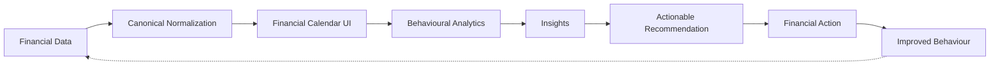

# Finora

> **Financial Behaviour Intelligence Platform**  
> *A clearer view of daily cash flow, financial habits, and the next decision.*

---

## 🌟 The Core Value Loop



Unlike generic personal finance dashboards that treat money as a static ledger, **Finora** introduces:
1. **The Financial Calendar**: Organizes canonical cash flow across days, weeks, and months.
2. **Canonical Transaction Architecture**: A unified transaction model for simulated bank streams and reviewed statement imports. CSV parsing is available; PDF/image OCR is optional and not yet accuracy-validated.
3. **Behavioural Intelligence**: Statistical spending summaries, forecasts, anomaly heuristics, and FIRE scenarios. The current system does not use a trained ML model or Isolation Forest.

---

## 🏛️ Architecture Overview

The system is built as a **Modular Monolith**:
- **Frontend**: Next.js 16.4.6 (App Router), TypeScript, Tailwind CSS, TanStack Query, Framer Motion, Recharts.
- **Backend API**: Python FastAPI, Pydantic v2 schemas, SQLAlchemy 2.0 async ORM.
- **Persistence**: Local development defaults to SQLite; Supabase Postgres is configured for hosted data. The initial schema migration is applied to the configured project.
- **Authentication**: Supabase Auth email/password, confirmation callback, password reset, and dashboard protection are implemented. Live signup and email delivery still need end-to-end verification.
- **Simulated Integrations**: Pluggable `BankAdapter` contracts (e.g. `HSBCDemoAdapter`) with zero storage of real credentials.

Detailed system documentation is available in `docs/`:
- [System High-Level Design (HLD)](docs/architecture/hld.md)
- [Low-Level Design (LLD)](docs/architecture/lld.md)
- [Database ER Schema](docs/architecture/database.md)
- [Canonical Transaction Pipeline](docs/architecture/transaction-flow.md)
- [Bank Adapter Architecture](docs/architecture/bank-adapters.md)
- [Statement Ingestion Engine](docs/architecture/statement-import.md)
- [ML & Behavioural Analytics](docs/architecture/ml-architecture.md)
- [Security & Privacy Architecture](docs/architecture/security.md)
- [Supabase setup and schema deployment](docs/supabase/setup.md)
- [Vercel deployment and environment variables](docs/deployment/vercel.md)
- [Product Requirements (PRD)](docs/product/requirements.md)
- [Engineering Roadmap](docs/product/roadmap.md)

Engineering and agent workflow:
- [Agent context](docs/agents/context.md)
- [Project continuity brief](docs/agents/project-context.md)
- [Milestone and decision history](docs/agents/history.md)
- [Website redesign workflow](docs/agents/skills/transform-ai-slop-websites/SKILL.md)
- [Agent roles](docs/agents/roles.md)
- [Contribution guide](CONTRIBUTING.md)
- [Security policy](SECURITY.md)

---

## 🚀 Getting Started

### 1. Backend Setup (FastAPI)
```bash
# Navigate to backend
cd backend

# Create & activate virtual environment
python3.13 -m venv .venv
source .venv/bin/activate

# Install dependencies
pip install -r requirements.txt

# Optional: enable local OCR for PDF, PNG, and JPG statements (Python 3.13)
pip install -r requirements-ocr.txt

# Run automated tests
DEBUG=false python -m pytest -q

# Launch FastAPI development server
uvicorn app.main:app --reload --port 8000
```
Interactive API docs available at: `http://localhost:8000/api/v1/docs`

### 2. Frontend Setup (Next.js)
```bash
# Navigate to frontend
cd frontend

# Install dependencies
npm install

# Run development server
npm run dev

# Validate frontend changes
npm run lint
npm run typecheck
npm run build
```
Client interface available at: `http://localhost:3000`
For Supabase sign-in and database setup, complete [the Supabase setup guide](docs/supabase/setup.md) first. Without project keys, the login page displays a configuration prompt.

### 3. Quality Checks

Run these checks before opening a pull request:

```bash
# Frontend
cd frontend
npm run lint
npm run typecheck
npm run build

# Backend
cd backend
pip install -r requirements-dev.txt
ruff check app tests
pytest
```

The frontend lint command uses ESLint's flat configuration with the Next.js and TypeScript rulesets. The backend Ruff configuration starts with high-signal import, undefined-name, syntax, and basic Pyflakes checks; broader style modernization can be introduced separately without making the initial quality gate noisy.

---

## 🛡️ Security & Privacy Principles
- **No Real Bank Credentials**: All bank sync operations use simulated adapter streams.
- **Granular Isolation**: Hosted-mode API access uses verified Supabase identities, transaction-scoped RLS, and tenant-scoped ORM queries. Local auth mode is demo-only.
- **Statement review**: CSV parsing maps recognized column layouts. Every row must be reviewed before confirmation; PDF and image extraction uses optional local PaddleX OCR and must be checked against the source.
- **Deterministic Deduplication**: SHA-256 fingerprints skip repeated transactions during statement imports.

## Frontend demo entry flow

The frontend opens on an explanatory landing page at `/`, with an interactive
cash-flow instrument, spending walkthrough, and wealth/FIRE scenario explorer.
The scenario uses visible assumptions and is not a prediction or investment
recommendation.

## Current integration status

- The login uses Supabase Auth SSR sessions, and the FastAPI API validates
  those access tokens and applies per-user Postgres row-level security.
- The initial Postgres migration and local environment templates are in this
  repository. The Supabase project exists, its local site URL and callback URLs
  are configured, and the project URL/publishable key are in the ignored local
  frontend and backend env files. The Session pooler URL is configured in
  `backend/.env`; the TLS connection succeeded, and the migration is applied
  with all ten expected tables protected by RLS.
- The signed-in workspace loads the current user's accounts and transactions
  from FastAPI. New users see an empty state and can create an account label,
  preview a statement, edit extracted rows, and explicitly confirm an import.
  The source file is not retained. Only confirmed canonical transactions are
  persisted.
- CSV import requires recognizable date and description columns plus separate
  debit/credit columns or an explicit transaction type; amount-only CSVs are
  rejected because direction cannot be inferred safely. PDF and image OCR require the optional local dependencies in
  `backend/requirements-ocr.txt`; OCR has not been benchmarked against bank
  layouts, and extracted rows require manual review.
- `sample-statement-3-months.csv` (repo root) is a synthetic demo statement, Sep 1 to Nov 23 2026, 146 rows in the `sample-passbook.csv` column format; it contains no real names, accounts or financial data.
- Calendar, insights, budgets and goals are part of the authenticated workspace.
  Roles/RBAC management, profile editing, billing, and real bank connections
  are not. Bank adapters remain simulated; the role editor is not authorization.

Open `/login` to create a Supabase Auth account or sign in, then enter
`/dashboard`. With no imported records, the workspace explains how to add a
statement. See
[`docs/supabase/setup.md`](docs/supabase/setup.md) for project setup, local
environment values, and applying the Postgres migration. Statement import saves
reviewed records to the user's account; bank sync remains simulated and does
not connect to real financial institutions.

Email confirmation is required. Sign-up keeps the user on the entry page while
they enter a six-digit code; verification then opens the empty workspace. The
Supabase Confirm signup email template must send `{{ .Token }}`, and hosted
delivery requires configured SMTP. See the Supabase setup guide for the steps.

The entry pages use self-hosted Instrument Serif (SIL OFL; license in
`frontend/public/fonts/OFL.txt`) and an adapted [Anatomy](https://github.com/wheresryan22/anatomy)
SVG kit (MIT; license in `frontend/src/lib/anatomy/LICENSE`).

The hero includes a pausable instrument tour and direct assembly selection. It
stops offscreen and respects reduced motion. The entry pages use a full-width
desktop layout, sticky login navigation, and self-hosted Instrument Serif with
DM Sans (license: `frontend/public/fonts/DM-Sans-OFL.txt`).
