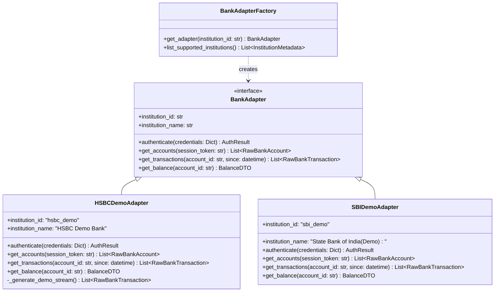

# Bank Adapter Architecture — Finora

## 1. Design Overview

Finora interacts with external banking systems strictly via the **Adapter Pattern**.

### Critical Safety Invariants
- **Zero Real Banking Secrets**: The system will never ask for, transmit, or store real banking passwords, 2FA tokens, or PINs.
- **Simulated Integration Baseline**: All development and demonstrations utilize mock banking adapters (e.g. `HSBCDemoAdapter`, `SBIDemoAdapter`) returning realistic, generated financial streams.
- **Pluggable Architecture**: The domain layer depends exclusively on the `BankAdapter` abstract base class.

---

## 2. Adapter Class Diagram

---

## 3. HSBC Demo Implementation Mechanics

The `HSBCDemoAdapter` generates deterministic yet rich behavioural patterns:
- **Salaried Income**: Bi-weekly or 1st-of-month salary credits.
- **Recurring Subscriptions**: Netflix, Spotify, AWS, Gym memberships on regular cycles.
- **Impulse Bursts**: Weekend dining out (Swiggy, Zomato) and late-night e-commerce (Amazon, Blinkit).
- **Utility Bills**: Electricity, broadband, mobile recharges mid-month.
- **Realistic Noise**: ATM withdrawals, UPI peer transfers with varying descriptions.
