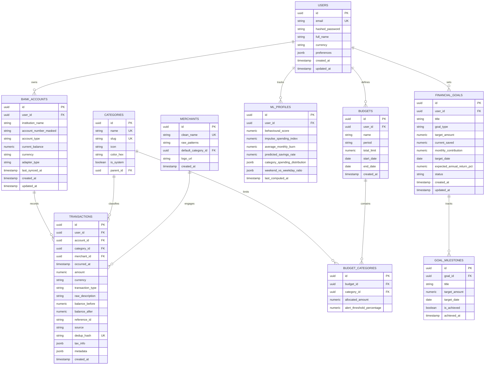

# Database Architecture & Schema Design — FinancialCall

## 1. Database Entity-Relationship (ER) Diagram

---

## 2. Table Specifications & Indexing Strategy

### 2.1 Indexing Optimizations
- **`transactions_user_occurred_at_idx`**: `(user_id, occurred_at DESC)` — Critical for high-speed Financial Calendar date-range scans.
- **`transactions_dedup_hash_idx`**: `(dedup_hash)` `UNIQUE` — Ensures deterministic idempotent bank syncing and multi-file statement imports.
- **`transactions_category_occurred_idx`**: `(category_id, occurred_at)` — Accelerates category-based budget utilization checks.
- **`accounts_user_idx`**: `(user_id)` — Quick retrieval of connected financial instruments.
- **`goals_user_status_idx`**: `(user_id, status)` — Fast computation of long-term financial independence metrics.

---

## 3. Data Integrity & Invariants

1. **Precision**: All financial quantities (`amount`, `balance_before`, `balance_after`, `target_amount`) use `NUMERIC(14, 2)`.
2. **Foreign Key Cascade Integrity**: `CASCADE` on user removal, `RESTRICT` on category and merchant deletion if transactions exist.
3. **Auditability**: `created_at` and `updated_at` timestamps with UTC timezone enforcement.
