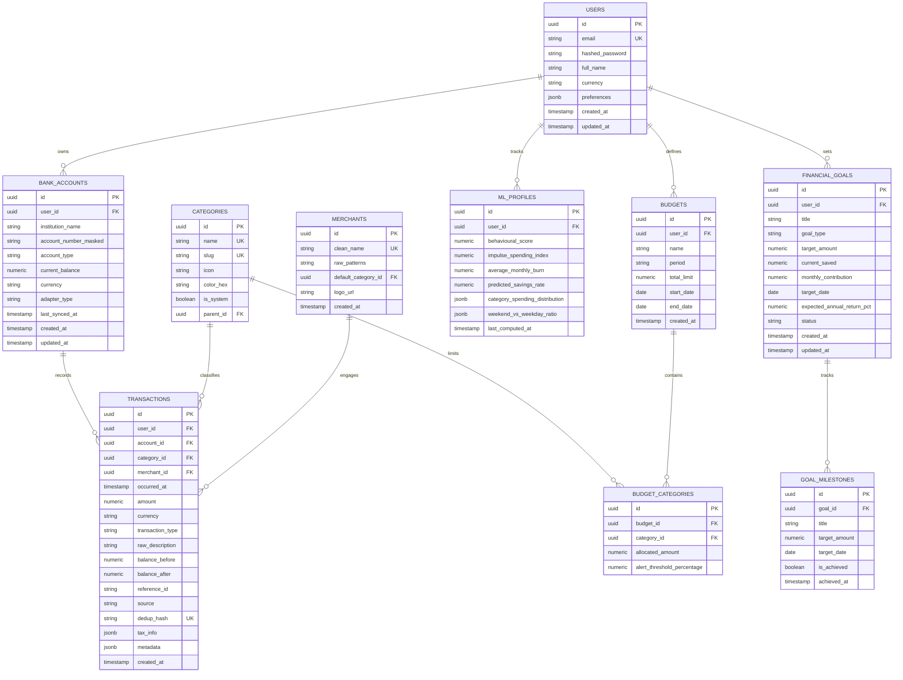

# Database Architecture & Schema Design — Finora

## 1. Database Entity-Relationship (ER) Diagram

---

## 2. Table Specifications & Indexing Strategy

### 2.1 Indexing Optimizations
- **`transactions_user_occurred_at_idx`**: `(user_id, occurred_at DESC)` — Critical for high-speed Financial Calendar date-range scans.
- **`transactions_dedup_hash_idx`**: `(dedup_hash)` `UNIQUE` — Ensures deterministic idempotent bank syncing and multi-file statement imports.
- **`transactions_category_occurred_idx`**: `(category_id, occurred_at)` — Accelerates category-based budget utilization checks.
- **`accounts_user_idx`**: `(user_id)` — Quick retrieval of connected financial instruments.
- **`goals_user_status_idx`**: `(user_id, status)` — Fast computation of long-term financial independence metrics.

---

## 3. Data Integrity & Invariants

1. **Precision**: All financial quantities (`amount`, `balance_before`, `balance_after`, `target_amount`) use `NUMERIC(14, 2)`.
2. **Foreign Key Cascade Integrity**: `CASCADE` on user removal, `RESTRICT` on category and merchant deletion if transactions exist.
3. **Auditability**: `created_at` and `updated_at` timestamps with UTC timezone enforcement.

---

## 4. TypeScript Prisma ORM Layer (Next.js & Vercel)

Finora integrates a serverless-optimized, zero-cost **Prisma ORM** layer in `frontend/prisma/schema.prisma` that directly maps to the Supabase PostgreSQL schema.

### 4.1 ORM Entity Mapping

| PostgreSQL Table | Prisma Model | Key Relations & Notes |
| :--- | :--- | :--- |
| `public.users` | `User` | Maps `auth_user_id` to Supabase Auth UUID. Owns accounts, budgets, goals. |
| `public.categories` | `Category` | Self-referential `parent_id` hierarchy. System and user categories. |
| `public.merchants` | `Merchant` | Clean merchant name with raw pattern array for automated canonical tagging. |
| `public.bank_accounts` | `BankAccount` | Masked accounts (`•••• 4821`), simulated adapters, Decimal precision. |
| `public.transactions` | `Transaction` | Immutable canonical transaction ledger with unique `dedup_hash`. |
| `public.budgets` | `Budget` | Monthly and custom spending thresholds. |
| `public.budget_categories` | `BudgetCategory` | Granular per-category budget ceilings and alert thresholds. |
| `public.financial_goals` | `FinancialGoal` | FIRE planning targets, monthly contributions, and expected returns. |
| `public.goal_milestones` | `GoalMilestone` | Stepped targets tracking progress towards financial independence. |
| `public.ml_profiles` | `MLProfile` | Behavioural score (0-100), burn rate, and impulse spending metrics. |

### 4.2 Data Access Layer (Clean Architecture)

The TypeScript layer implements the **Repository Pattern** and **Dependency Inversion Principle**:
- **Interfaces (`frontend/src/server/repositories/interfaces.ts`)**: `IUserRepository`, `IBankAccountRepository`, `ITransactionRepository`, `IBudgetRepository`, `IFinancialGoalRepository`.
- **Prisma Implementation (`frontend/src/server/repositories/prisma/`)**: Direct database access via `@prisma/client` with pooled connections for Vercel Serverless.
- **Demo Mode Implementation (`frontend/src/server/repositories/demo/`)**: In-memory typed repository wrapping synthetic financial datasets (`demo-data.ts`).
- **Repository Factory (`frontend/src/server/repositories/factory.ts`)**: Dynamically resolves implementations based on `DATABASE_URL` presence, ensuring zero broken builds and seamless local/offline execution.
- **Seeder (`frontend/prisma/seed.ts`)**: Automates loading of synthetic demo records into Supabase PostgreSQL.

