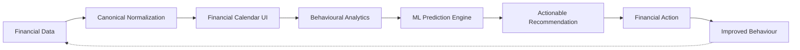

# System High-Level Design (HLD) — Finora

## 1. Executive Summary & Vision

**Finora** is a **Financial Behaviour Intelligence Platform**, not a generic banking clone or basic expense tracker.

### The Core Value Loop


- **Primary Transaction Interface**: Financial Calendar (time-axis positioning, day/week/month financial density, timestamped event blocks).
- **Primary Intelligence Interface**: Financial Behaviour Dashboard (cash flow dynamics, burn rate, impulse score, runway).
- **ML Intelligence Layer**: Behavioural feature extraction, anomaly detection, spending forecasts, budget exhaustion predictions, and goal attainment timelines.
- **Financial Goal Engine**: Dynamic link between daily spending choices and long-term Financial Independence / Early Retirement (FIRE) targets.

---

## 2. Core Architectural Principles

1. **Modular Monolith**: Strict domain isolation within a unified, deployable service boundary. Zero speculative microservices, Kafka clusters, or distributed orchestrators.
2. **Canonical Transaction Core**: Every source (Bank Adapter, CSV, XLSX, PDF) maps into a single, immutable, strongly-typed Canonical Transaction Model before reaching the database or analytics engine.
3. **Simulated Financial Integrations (Privacy & Compliance First)**: Realistic banking simulations via `BankAdapter` contracts (e.g., `HSBCDemoAdapter`). No storage of plaintext credentials or real banking secrets.
4. **Deterministic Foundations Before Advanced AI**: Solid statistical models (rolling averages, exponential decay, trend regressions) provide baseline predictions; machine learning (Isolation Forests, Random Forests) enhances classification and anomaly detection without black-box fragility.
5. **Calendar-First Mental Model**: Users perceive money not as flat line items, but as temporal events occurring throughout daily routines.

---

## 3. System Architecture

```mermaid
flowchart TB
    subgraph ClientLayer [Client Presentation Layer - Next.js App Router]
        UI_Calendar[Financial Calendar Engine\nDay / Week / Month Views]
        UI_Dashboard[Behaviour Intelligence Dashboard]
        UI_Goals[Financial Independence Planner]
        UI_Statement[Statement Ingestion Portal]
        UI_Detail[Transaction Intelligence Drawer]
        QueryClient[TanStack Query State Cache]
    end

    subgraph APILayer [Application & API Gateway - FastAPI]
        RouterAuth[/api/v1/auth]
        RouterTx[/api/v1/transactions]
        RouterCal[/api/v1/calendar]
        RouterBank[/api/v1/bank]
        RouterImport[/api/v1/statements]
        RouterBudget[/api/v1/budgets]
        RouterGoals[/api/v1/goals]
        RouterAnalytics[/api/v1/analytics]
        RouterML[/api/v1/ml]
    end

    subgraph DomainServices [Domain & Application Services]
        SvcTx[Transaction Normalization Service]
        SvcBank[Bank Integration Service\nAdapter Factory]
        SvcImport[Statement Parser & Deduplication Engine]
        SvcBudget[Budget & Burn Analysis Service]
        SvcGoal[Goal Projection & Scenario Engine]
        SvcML[Behavioural ML & Forecasting Engine]
    end

    subgraph DataLayer [Persistence & Storage - PostgreSQL]
        DB_Core[(Relational Core\nUsers, Accounts, Canonical Tx)]
        DB_Meta[(Metadata & Classifications\nMerchants, Categories)]
        DB_Budget[(Financial State\nBudgets, Goals, Milestones)]
        DB_ML[(Derived Feature Store\nML Profiles, Anomaly Logs)]
    end

    ClientLayer -->|HTTPS / JSON / Bearer JWT| APILayer
    APILayer --> DomainServices
    DomainServices --> DataLayer
```

---

## 4. Subsystem Breakdown

### 4.1 Frontend Client (Next.js & TypeScript)
- **Framework**: Next.js 15+ (App Router architecture with React Server Components + Client interactivity).
- **Design Language**: Tailored dark-mode, high-density financial layout using Tailwind CSS, Radix UI primitives, Lucide icons.
- **State Management**: TanStack Query v5 for server state caching, optimistic updates, and cache invalidation.
- **Visualizations**: Recharts for cash flow trajectories, budget gauges, and Framer Motion for interactive calendar transitions.

### 4.2 Application Backend (FastAPI)
- **Framework**: FastAPI (Async Python 3.12+), Pydantic v2 validation models.
- **Database Access**: SQLAlchemy 2.0 (Async Session) with Alembic migration governance.
- **Security**: Argon2id / bcrypt password hashing, stateless RS256/HS256 JWT tokens, granular role-based scopes.

### 4.3 Ingestion & Bank Integration Subsystem
- **Simulated Bank Engine**: Extensible `BankAdapter` abstract base class. Initial concrete implementation: `HSBCDemoAdapter`.
- **Document Ingestion Engine**: Stream-based parsers for CSV, XLSX, and vector/text-based PDF statements with regex extraction and table normalization.

### 4.4 ML & Analytics Subsystem
- **Feature Store & Extraction**: Rolling window calculations (7-day, 30-day, 90-day spend velocity, weekend vs weekday spending ratios, merchant concentration).
- **Forecasting**: Deterministic linear regressions + Holt-Winters exponential smoothing for month-end budget burn projections.
- **Anomaly Detection**: Isolation Forest on transaction vector embeddings (amount, time of day, category deviation).
- **Recommendation Engine**: Rule-weighted heuristics paired with behavioural cluster scoring.

---

## 5. Non-Functional Requirements (NFRs)

| Metric | Target | Implementation Strategy |
| :--- | :--- | :--- |
| **P95 API Latency** | < 120ms | Indexed PostgreSQL queries, lean Pydantic serializers |
| **Calendar Query P95** | < 80ms | Date-range partition queries on `occurred_at` index |
| **Statement Parsing** | < 2.5s for 1,000 tx | In-memory pandas processing with chunked database inserts |
| **Security & Privacy** | OWASP Top 10 Compliant | Sanitized inputs, strict CORS, masked account numbers, zero plaintext secrets |
| **Data Integrity** | Zero duplicate transactions | Compound uniqueness hash (`account_id` + `occurred_at` + `amount` + `reference_id`) |
