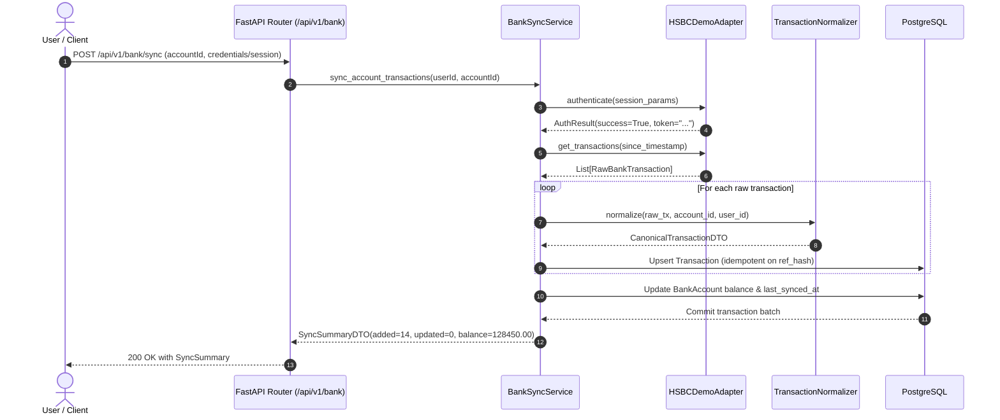

# Low-Level Design (LLD) — Finora

## 1. Module & Directory Structure

The repository follows a clean, modular monolith structure separating frontend presentation from domain-driven backend modules.

```
financical/
├── backend/
│   ├── app/
│   │   ├── api/
│   │   │   ├── v1/
│   │   │   │   ├── auth.py
│   │   │   │   ├── bank.py
│   │   │   │   ├── calendar.py
│   │   │   │   ├── transactions.py
│   │   │   │   ├── statements.py
│   │   │   │   ├── budgets.py
│   │   │   │   ├── goals.py
│   │   │   │   ├── analytics.py
│   │   │   │   └── router.py
│   │   │   └── deps.py
│   │   ├── core/
│   │   │   ├── config.py
│   │   │   ├── database.py
│   │   │   ├── security.py
│   │   │   └── exceptions.py
│   │   ├── db/
│   │   │   ├── base.py
│   │   │   └── models/
│   │   │       ├── user.py
│   │   │       ├── account.py
│   │   │       ├── transaction.py
│   │   │       ├── merchant.py
│   │   │       ├── category.py
│   │   │       ├── budget.py
│   │   │       ├── goal.py
│   │   │       └── ml_profile.py
│   │   ├── domain/
│   │   │   ├── bank_adapters/
│   │   │   │   ├── base.py
│   │   │   │   ├── factory.py
│   │   │   │   └── hsbc_demo.py
│   │   │   ├── statement_import/
│   │   │   │   ├── parser.py
│   │   │   │   ├── normalizer.py
│   │   │   │   └── deduplicator.py
│   │   │   ├── ml/
│   │   │   │   ├── features.py
│   │   │   │   ├── forecaster.py
│   │   │   │   ├── anomaly.py
│   │   │   │   └── recommendations.py
│   │   │   └── services/
│   │   │       ├── transaction_service.py
│   │   │       ├── calendar_service.py
│   │   │       ├── budget_service.py
│   │   │       └── goal_service.py
│   │   ├── schemas/
│   │   │   ├── auth.py
│   │   │   ├── canonical_transaction.py
│   │   │   ├── calendar.py
│   │   │   ├── bank.py
│   │   │   ├── budget.py
│   │   │   ├── goal.py
│   │   │   └── analytics.py
│   │   └── main.py
│   ├── tests/
│   │   ├── conftest.py
│   │   ├── test_auth.py
│   │   ├── test_bank_adapters.py
│   │   ├── test_calendar.py
│   │   ├── test_canonical_transactions.py
│   │   ├── test_statement_parsers.py
│   │   ├── test_ml_forecaster.py
│   │   └── test_goal_service.py
│   └── requirements.txt
│
├── frontend/
│   ├── src/
│   │   ├── app/
│   │   │   ├── layout.tsx
│   │   │   ├── page.tsx
│   │   │   ├── (auth)/
│   │   │   │   ├── login/page.tsx
│   │   │   │   └── register/page.tsx
│   │   │   ├── (dashboard)/
│   │   │   │   ├── calendar/page.tsx
│   │   │   │   ├── dashboard/page.tsx
│   │   │   │   ├── accounts/page.tsx
│   │   │   │   ├── budgets/page.tsx
│   │   │   │   ├── goals/page.tsx
│   │   │   │   └── import/page.tsx
│   │   ├── components/
│   │   │   ├── calendar/
│   │   │   │   ├── CalendarView.tsx
│   │   │   │   ├── DayGrid.tsx
│   │   │   │   ├── WeekGrid.tsx
│   │   │   │   ├── MonthGrid.tsx
│   │   │   │   └── TransactionEventBlock.tsx
│   │   │   ├── transactions/
│   │   │   │   ├── TransactionDetailDrawer.tsx
│   │   │   │   └── PredictiveContextCard.tsx
│   │   │   ├── dashboard/
│   │   │   │   ├── BehaviourScoreCard.tsx
│   │   │   │   ├── CashFlowTrajectoryChart.tsx
│   │   │   │   └── AnomalyAlertList.tsx
│   │   │   ├── common/
│   │   │   └── ui/
│   │   ├── hooks/
│   │   │   ├── useCalendar.ts
│   │   │   ├── useTransactions.ts
│   │   │   └── usePredictiveBurn.ts
│   │   ├── lib/
│   │   │   ├── api.ts
│   │   │   └── utils.ts
│   │   └── types/
│   │       ├── api.ts
│   │       ├── calendar.ts
│   │       └── transaction.ts
│   ├── package.json
│   ├── tsconfig.json
│   └── tailwind.config.ts
│
└── docs/
```

---

## 2. Component Collaboration & Sequence Diagram

### 2.1 Bank Sync Flow


---

## 3. Data Transfer Objects (DTOs) & Contracts

### 3.1 Canonical Transaction Schema
```python
class CanonicalTransactionDTO(BaseModel):
    id: UUID
    user_id: UUID
    account_id: UUID
    occurred_at: datetime
    amount: Decimal
    currency: str = "INR"
    transaction_type: TransactionType  # DEBIT, CREDIT, TRANSFER
    merchant_name: str
    merchant_id: Optional[UUID] = None
    category_name: str
    category_id: Optional[UUID] = None
    balance_before: Optional[Decimal] = None
    balance_after: Optional[Decimal] = None
    reference_id: str
    source: TransactionSource  # BANK_API, CSV, XLSX, PDF, MANUAL
    tax_info: Optional[TaxMetadata] = None
    metadata: Dict[str, Any] = Field(default_factory=dict)
```

---

## 4. Error Handling & Invariant Enforcement

1. **Monetary Precision**: All currency amounts use `Decimal` (Python) and `NUMERIC(14, 2)` (Postgres) to avoid floating-point errors.
2. **Transaction Immutability**: Historical transactions cannot have amounts or timestamps mutated without generating an audit entry.
3. **Idempotency**: All ingestion endpoints utilize deduplication hashes `SHA256(account_id + occurred_at_iso + amount + reference_id)` preventing double-counting.
