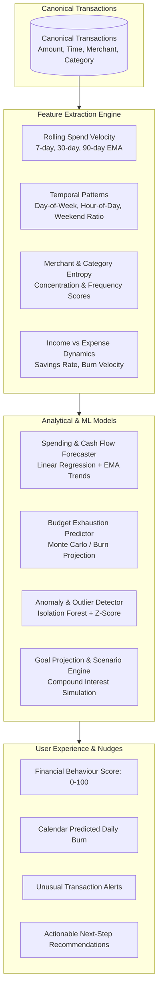

# Machine Learning & Behavioural Analytics Architecture — Finora

## 1. Intelligence Vision & Guiding Philosophy

Finora rejects "AI theater" (e.g. wrapping trivial sum queries in LLM prompts or training opaque neural networks on sparse tabular data).

Instead, our intelligence subsystem follows a **three-tier progressive architecture**:
1. **Tier 1: Deterministic & Statistical Modeling** (Rolling aggregates, EMA, rate-of-change, linear trendlines).
2. **Tier 2: Classic Machine Learning** (Isolation Forest for spending anomalies, Random Forest / GBDT for multi-variable category forecasting).
3. **Tier 3: Behavioural Rule & Recommendation Engine** (Actionable financial nudge generator).

---

## 2. ML Pipeline & Data Flow

---

## 3. Feature Store Schema

| Feature Name | Type | Description |
| :--- | :--- | :--- |
| `burn_rate_daily_avg_30d` | `Decimal` | Average daily expenditure over the prior 30 days. |
| `weekend_spend_ratio` | `Float` | Percentage of total discretionary spending occurring on Sat/Sun. |
| `discretionary_spend_ratio`| `Float` | Dining, Shopping, Entertainment vs. Rent, Utilities, Groceries. |
| `impulse_index` | `Float (0-1.0)`| Proportion of unplanned transactions with high frequency & variance. |
| `savings_rate` | `Float` | `(Net Income - Total Spend) / Net Income`. |
| `runway_days` | `Integer` | Liquid account balance / average daily burn rate. |

---

## 4. Anomaly Detection & Forecasting Heuristics

- **Isolation Forest**: Trained per-user when transaction count > 50. Outlier score indicates unusual volume, odd time of day, or rare merchant.
- **Budget Exhaustion**:
  $$\text{Projected Exhaustion Day} = \frac{\text{Budget Limit} - \text{Current Spend}}{\text{Rolling 7-Day Average Daily Spend}} + \text{Current Day}$$
  If $\text{Projected Exhaustion Day} < \text{Days in Month}$, a budget breach alert is flagged.
