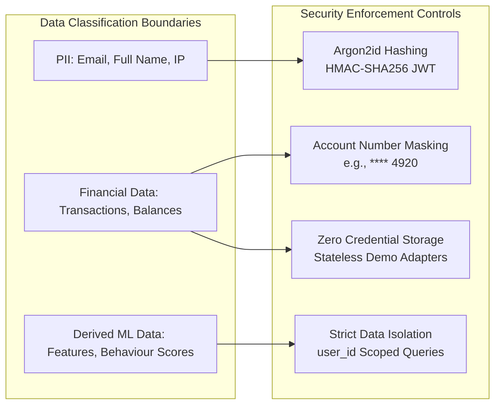

# Security & Privacy Architecture — Finora

## 1. Security First Principles

Financial applications demand defense-in-depth, strict data segregation, and privacy preservation.

---

## 2. Authentication & Authorization

- **Password Storage**: Passwords hashed using `argon2id` (or `bcrypt` with work factor 12).
- **Token Strategy**: Stateless JWT access tokens (short-lived: 15 minutes) paired with HTTP-only, secure, SameSite cookies for refresh tokens.
- **Tenant Isolation**: Every database query on sensitive entities (`BankAccount`, `Transaction`, `Budget`, `FinancialGoal`) explicitly enforces `user_id == current_user.id`.

---

## 3. Threat Modeling & OWASP Hardening

1. **SQL Injection**: Prevented via SQLAlchemy ORM parameterized queries. Zero raw string interpolation.
2. **Cross-Site Scripting (XSS)**: Next.js automatic React escaping + strict Content Security Policy (CSP).
3. **Cross-Site Request Forgery (CSRF)**: SameSite=Lax/Strict cookie policies + Anti-CSRF token verification on state-changing POST/PUT/DELETE requests.
4. **Rate Limiting**: IP and User-based token bucket rate limiting on sensitive endpoints (`/auth/login`, `/statements/upload`, `/bank/sync`).
5. **Malicious File Ingestion**: Ingestion endpoint validates magic bytes, enforces maximum file size (15MB), and processes in isolated memory buffers without executing filesystem scripts.
