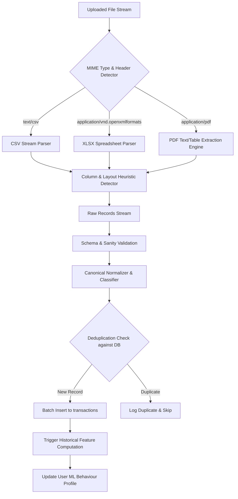

# Historical Statement Ingestion Architecture — Finora

## 1. Overview & Ingestion Life Cycle

Users frequently hold years of historical statement records in varied formats (CSV, XLSX, PDF). The Ingestion Engine processes multi-year banking archives and converts them into canonical transaction records seamlessly.

---

## 2. Parsing Architecture

---

## 3. Supported File Formats & Extractors

### 3.1 CSV Parser
- Auto-detects delimiters (`,`, `;`, `\t`, `|`).
- Heuristic header detection scanning for common financial terms (`Date`, `Narration`, `Description`, `Debit`, `Credit`, `Withdrawal`, `Deposit`, `Balance`).

### 3.2 XLSX Parser
- Inspects worksheet sheets; automatically selects the sheet with the densest numerical and date matrix.
- Handles formatted dates, floating point serials, and custom currency formatting.

### 3.3 PDF Parser
- Vector & text coordinate table extraction.
- Regex fallbacks for standard Indian and Global bank statement layouts (HDFC, SBI, ICICI, HSBC, Chase, Barclays).
