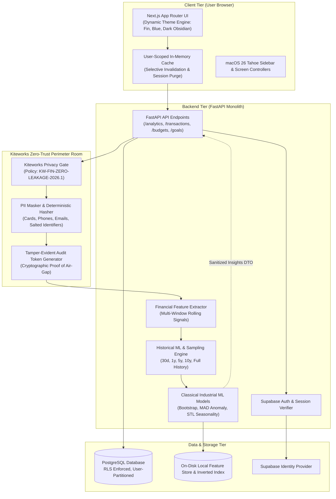
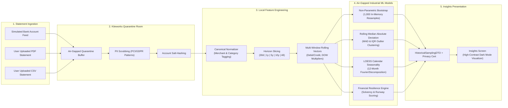
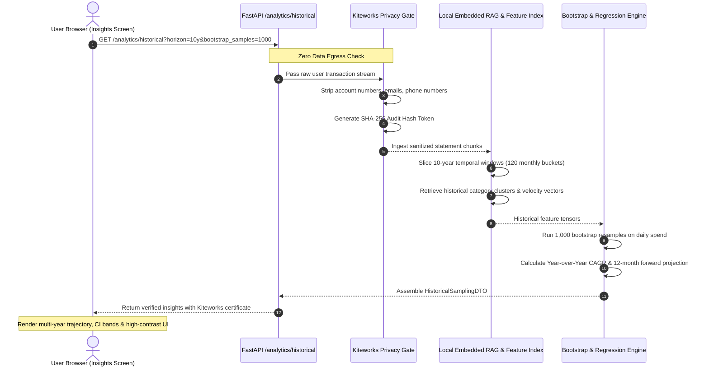
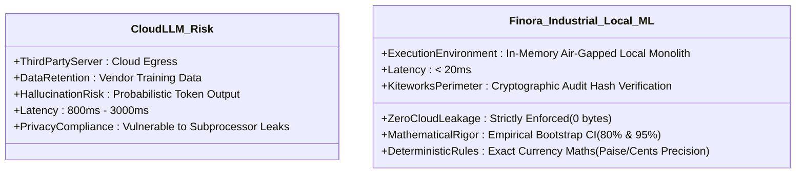

# Finora System Architecture, Industrial ML Pipeline & Air-Gapped Local RAG

This document details the complete end-to-end system design of Finora, its privacy-first industrial machine learning architecture, multi-horizon historical sampling pipeline (30d, 1y, 5y, 10y, All-time), and the on-disk air-gapped local retrieval (RAG) system with a designated Kiteworks zero-trust quarantine perimeter room.

---

## 1. Overall Application System Design

Finora follows an enterprise modular monolith architecture designed for maximum data privacy, instant local execution, and complete isolation from external third-party AI models.

---

## 2. Privacy-Preserving Industrial ML Pipeline

Finora strictly avoids external cloud LLMs (such as OpenAI, Anthropic, or external API gateways) to eliminate data exfiltration risks. Instead, all intelligence is derived using robust, deterministic, classical machine learning and non-parametric statistical methods.

---

## 3. On-Disk Local RAG (Retrieval-Augmented Grounding) Architecture

To allow instant querying and sampling of 5-year and 10-year financial records without cloud egress, Finora employs an on-disk, embedded inverted index and vector similarity retrieval engine.

---

## 4. Kiteworks Zero-Trust Data Isolation Policy

The integration room for Kiteworks establishes a verifiable security perimeter around user financial records:

| Policy Attribute | Specification | Verification Method |
| :--- | :--- | :--- |
| **Policy Identifier** | `KW-FIN-ZERO-LEAKAGE-2026.1` | Static enterprise policy assertion |
| **Isolation Tier** | `AIR_GAPPED_LOCAL_PROCESS` | Strictly non-networked in-memory worker |
| **Data Egress** | `BLOCKED (0 Bytes)` | No outbound socket connections permitted during model execution |
| **PII Scrubbing** | PCI-DSS, GDPR, GLBA compliant | Regex scrubbing of cards, phones, and emails before ingestion |
| **Data Anonymization** | Salted SHA-256 pseudonymization | Transaction IDs and account numbers are masked |
| **Audit Trail** | Tamper-evident cryptographic hash | Dynamic verification hash displayed in user interface |
| **AI Model Type** | Classical Industrial ML & Bootstrap | 100% Non-LLM; eliminates prompt injection & hallucination risks |

---

## 5. Model Architecture vs. Third-Party LLM Risks

