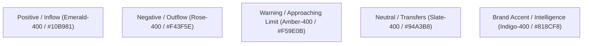

# Design System & Token Specifications — Finora

## 1. Visual Identity & Atmosphere

Finora uses a high-density, typography-first financial aesthetic engineered for readability and cognitive calm.

### Semantic Financial Palette

| Token | Class / Value | Semantic Use |
| :--- | :--- | :--- |
| `color-inflow` | `text-emerald-400`, `bg-emerald-500/10` | Salary credits, investment returns, savings growth |
| `color-outflow`| `text-slate-100` (primary) / `text-rose-400` (overrun) | Everyday expenses, bill debits |
| `color-warning`| `text-amber-400`, `bg-amber-500/10` | Budget velocity breaches, unusual spike anomalies |
| `color-neutral`| `text-slate-400`, `bg-slate-800` | Transfers between owned accounts, metadata |
| `color-brand`  | `text-indigo-400`, `bg-indigo-600` | Intelligence badges, predictive forecasts, primary CTAs |

---

## 2. Typography Hierarchy

- **Font Family**: Inter, SF Pro, or system sans-serif with tabular numerical figures (`tabular-nums` / font-mono for monetary quantities).
- **Display Metric**: `text-2xl` to `text-3xl font-bold font-mono tracking-tight`
- **Section Heading**: `text-base md:text-lg font-semibold text-slate-100 tracking-tight`
- **Subtext & Labels**: `text-xs font-medium text-slate-400`
- **Micro-labels / Timestamps**: `text-[11px] font-mono text-slate-500`

---

## 3. Surface Elevation & Borders

- **Canvas Background**: `bg-slate-950` (`#020617`)
- **Card Surface**: `bg-slate-900/70 border border-slate-800/80 backdrop-blur-md`
- **Elevated Drawer**: `bg-slate-900 border-l border-slate-800 shadow-2xl`
- **Input Fields**: `bg-slate-950 border border-slate-800 focus:border-indigo-500`
- **Radii**: Standard `rounded-xl` for cards, `rounded-lg` for buttons and event pills.
