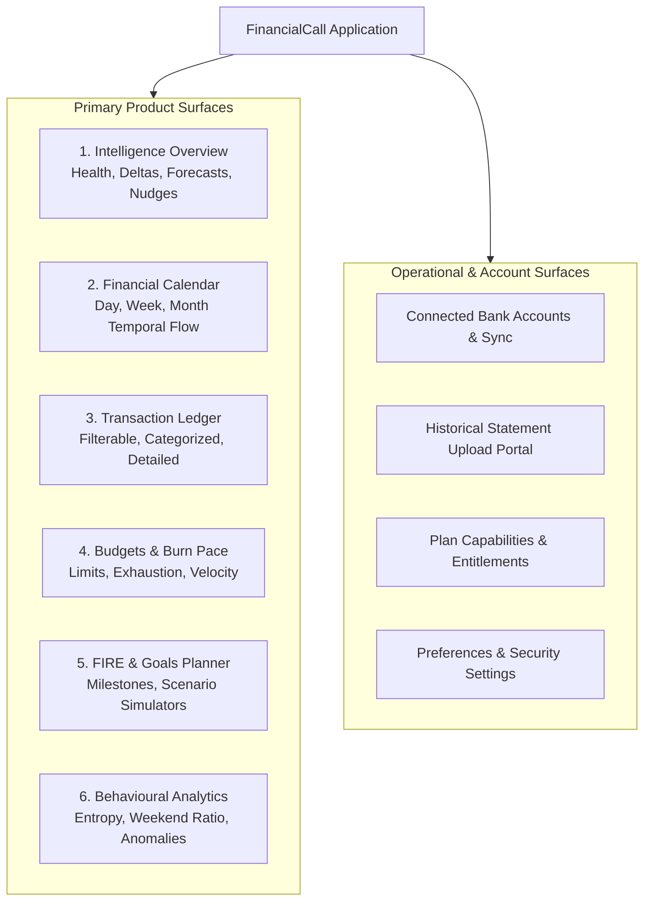

# Information Architecture — FinancialCall

## 1. Product Navigation Tree

---

## 2. Interaction Flows

### 2.1 Calendar → Transaction Detail Flow
1. User scans monthly heatmap or weekly schedule.
2. Identifies a peak expenditure block (e.g., `-₹3,800 Toit Brewpub`).
3. Clicks event block → Slide-over Drawer opens with Progressive Disclosure:
   - **Level 1**: Exact timestamp, merchant name, category, settled balance.
   - **Level 2**: Impact on weekly budget velocity (e.g., "Consumes 24% of remaining entertainment budget").
   - **Level 3**: Actionable recommendation and forecast adjustment.

### 2.2 Statement Ingestion Flow
1. Drag-and-drop statement file (CSV, XLSX, PDF).
2. Format auto-detection & schema mapping preview.
3. In-memory deduplication & anomaly scan.
4. Summary confirmation: "184 transactions added, 12 duplicates safely skipped".
5. Immediate update across Calendar, Budgets, and Intelligence metrics.
