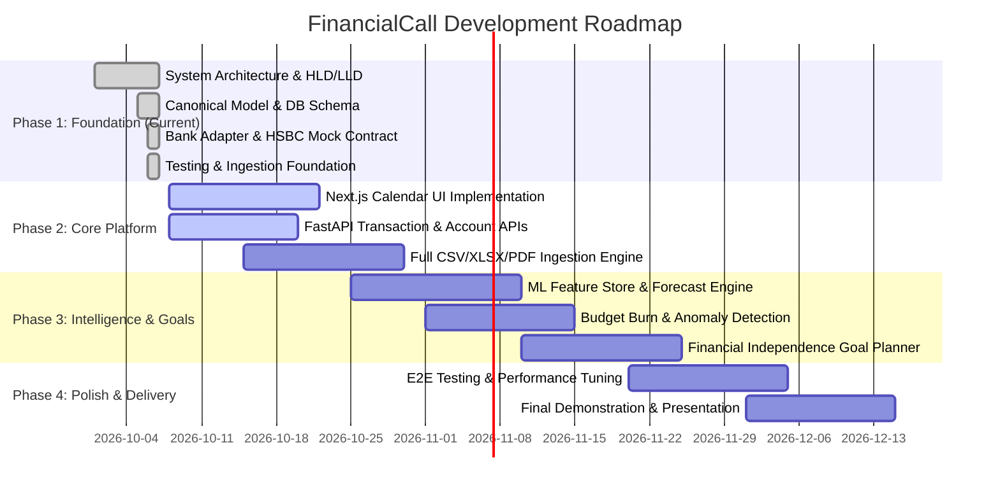

# Engineering & Product Roadmap — FinancialCall

---

## Milestone Deliverables

### Phase 1: Architectural Foundation (Delivered)
- Full System HLD, LLD, ER diagrams, security model, and API contracts.
- Backend domain boundaries: Canonical Transaction Model, BankAdapter abstraction, `HSBCDemoAdapter`.
- Modern relational database models (SQLAlchemy) & Pydantic schemas.
- Ingestion parser contracts & baseline ML forecasting abstractions.
- Automated test suites verifying normalization, bank adapters, and calendar algorithms.

### Phase 2: Core Calendar & Transaction Platform
- Interactive Next.js Calendar with Day/Week/Month time-axis grids.
- Transaction detail drawer with predictive context indicators.
- Ingestion UI with drag-and-drop CSV/XLSX/PDF statement upload and preview.

### Phase 3: Behavioural ML & Goal Planning
- Rolling 7d/30d/90d feature computation background jobs.
- Isolation Forest anomaly detection for uncharacteristic transactions.
- Interactive FIRE goal simulator with monthly adjustment sliders.

### Phase 4: Production Polish
- End-to-end Cypress/Playwright integration tests.
- High-concurrency query optimization and caching.
