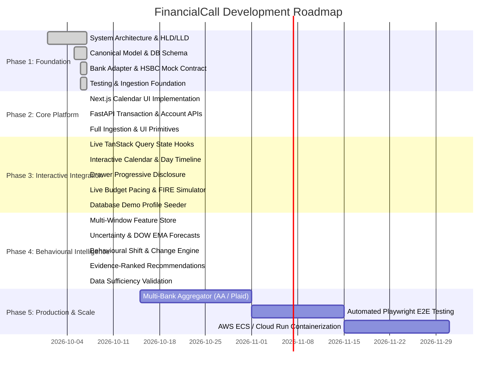

# Engineering & Product Roadmap — FinancialCall

---

## Milestone Deliverables

### Phase 1: Architectural Foundation (Delivered)
- Full System HLD, LLD, ER diagrams, security model, and API contracts.
- Backend domain boundaries: Canonical Transaction Model, BankAdapter abstraction, `HSBCDemoAdapter`.
- Modern relational database models (SQLAlchemy) & Pydantic schemas.
- Ingestion parser contracts & baseline ML forecasting abstractions.
- Automated test suites verifying normalization, bank adapters, and calendar algorithms.

### Phase 2: Design System & UX Foundations (Delivered)
- Reusable Tailwind design tokens and UI component library (`Button`, `Badge`, `Card`, `Tabs`, `LoadingSkeleton`, `EmptyState`).
- Cohesive AppShell layout with multi-surface navigation hierarchy.
- Comprehensive product definitions: UX principles, information architecture, and entitlement models.

### Phase 3: Interactive Product Experience & Live Data (Delivered)
- End-to-end integration between Next.js frontend and FastAPI domain services via TanStack React Query.
- Financial Calendar: Live month/week/day view modes, month stepper, category filters, and today anchor.
- Transaction Intelligence: Progressive disclosure drawer showing budget utilization, projected spend, and statistical anomaly detection.
- Budget & Burn Engine: Live pacing calculators, category limit tracking, and dynamic budget target modification.
- FIRE Goals Simulator: Real-time compound calculation scenario slider and milestone creator.
- Statement Ingestion Portal: Drag-and-drop CSV parser with SHA-256 deduplication and cache invalidation.
- Comprehensive accessibility enhancements (ARIA dialogs, focus rings, keyboard escape handling).

### Phase 4: Financial Behaviour Intelligence & Forecasting (Delivered)
- Multi-window rolling feature engineering (7d, 30d, 90d daily velocity, Herfindahl-Hirschman concentration index, weekend velocity multipliers, impulse index).
- Multi-horizon forecasting with day-of-week cyclicality and 80% prediction uncertainty intervals.
- Statistical and category-aware anomaly detector with duplicate charge detection and materiality filtering.
- Rolling behavioural change detector comparing active 30-day windows with 60-day historical baselines.
- Evidence-grounded, ranked recommendation engine structured with explicit triggers, evidence, monthly financial impact, and concrete actions.
- Transparent data sufficiency rules preventing manufactured insights on insufficient history.
- Full Next.js frontend intelligence dashboard with responsive metrics, forecast bands, and actionable nudges.

### Phase 5: Scale & Production Hardening (Planned)
- Account aggregator integrations (India AA / Open Banking / Plaid).
- End-to-end automated UI test harnesses with Playwright.
- Containerization (Docker, Docker Compose), CI/CD quality gates, and cloud deployment on AWS ECS/Cloud Run.
